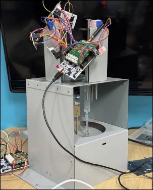
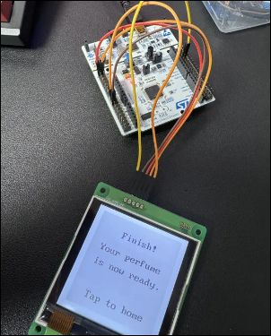
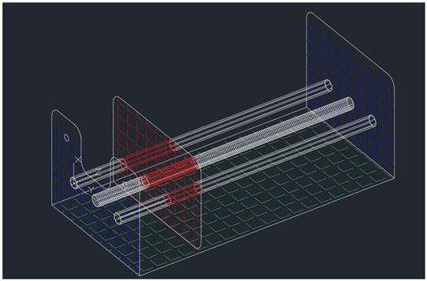
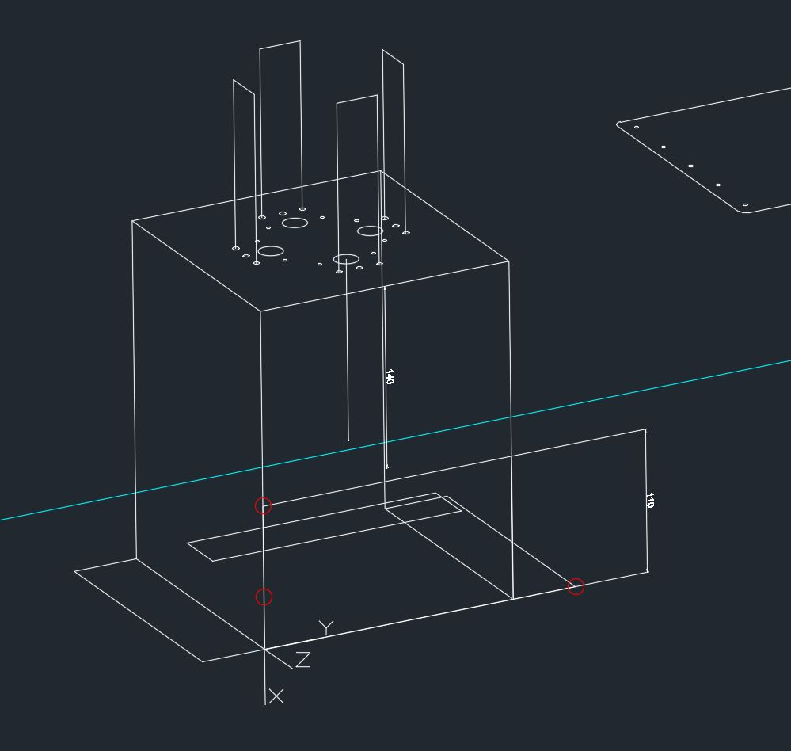
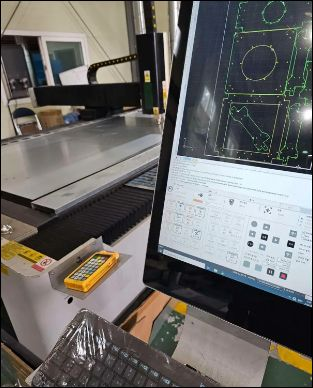
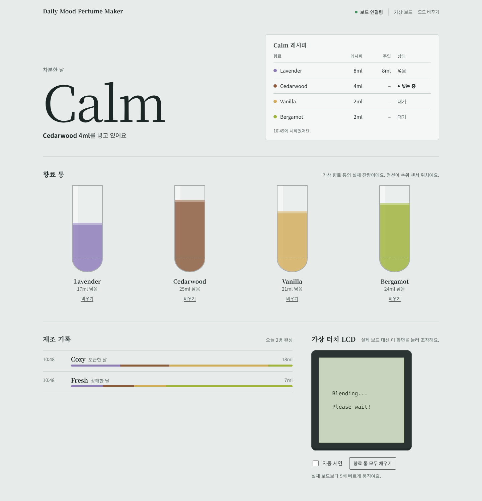

# Daily Mood Perfume Maker

터치 LCD 에서 오늘의 기분을 고르면, 기분에 맞는 레시피로 향료 4종(Lavender, Cedarwood, Vanilla, Bergamot)을 즉석에서 섞어 향수를 만들어 주는 IoT 향수 제조기입니다.

> 2025년 2학기 **사물인터넷프로그래밍** 7조 기말 프로젝트
> 팀원: 김동아, 김민규, 박준수, 이승훈, 이채원
> 원본 저장소: [tmdgns5136/IOT-Programming7](https://github.com/tmdgns5136/IOT-Programming7) (브랜치별 코드를 이 저장소에 폴더별로 모았습니다)

<p>
  
  
</p>

**바로 체험하기** — 부품이 없어도 브라우저에서 가상 보드로 향수를 만들어 볼 수 있습니다. ([아래 배포 안내](#-바로-체험하기-배포된-페이지) 참고)

## 💡 아이디어

두바이의 고급 향수 자판기에서 착안해, 사용자의 기분에 맞춘 **일회용 맞춤 향수를 그 자리에서 만들어 주는 기계**를 기획했습니다. 칵테일 자판기의 맞춤형 제조 방식도 참고했습니다.

| 기분 | Lavender | Cedarwood | Vanilla | Bergamot |
|------|---------:|----------:|--------:|---------:|
| Fresh (상쾌한 날) | 1 | 1 | 1 | 4 |
| Calm (차분한 날) | 8 | 4 | 2 | 2 |
| Bold (자신 있는 날) | 2 | 6 | 2 | 4 |
| Sweet (달콤한 날) | 4 | 2 | 8 | 2 |
| Active (활기찬 날) | 2 | 2 | 2 | 10 |
| Cozy (포근한 날) | 4 | 4 | 8 | 2 |
| Mystic (깊고 신비로운 날) | 1 | 4 | 1 | 1 |

단위는 ml 이며 `main-board/Core/Src/main.c` 의 `RECIPES[][]` 와 같습니다. Random 을 고르면 위 일곱 가지 중 하나를 무작위로 만듭니다.

## 🔧 하드웨어

**주사기 디스펜서를 직접 만든 이유** — 향수는 액체를 작은 단위로 정밀하게 나눠야 해서 주사기를 쓰기로 했습니다. 하지만 시중 부품은 예산을 크게 넘었습니다.

| 검토한 방식 | 문제 |
|------------|------|
| 워터펌프 (연동식) | 개당 약 4.4만 원으로 예산 대비 비쌈 |
| 리니어 기어 (액추에이터) | 개당 약 20~30만 원 |
| 시중 주사기 디스펜서 | 개당 약 20만 원 |
| **리드 스크류 + 스테핑 모터 (채택)** | 직접 제작해 저렴하고, 스텝 수로 주입량을 정밀하게 제어 |

스테핑 모터가 1바퀴(4096 스텝) 돌 때 주사기가 1ml 를 밀어내도록 만들었습니다.

<p>
  
  
  
</p>

**제작 과정**
1. 폼보드·아크릴판으로 시작했지만 내구성과 가공성 문제로 실패
2. GI 강판으로 바꿔 CAD 로 도면을 그리고 CNC 레이저로 절단
3. 볼트 구멍 오차가 0.3mm 를 넘으면 모터 힘이 제대로 전달되지 않아, 0.3mm 이하로 맞춰 정밀도 확보

**구성**
- 메인보드 (STM32 NUCLEO-F446RE): 터치 LCD, 공병을 돌리는 밑판 모터, LoRa 마스터
- 서브보드 (STM32 NUCLEO-F446RE): LoRa 로 명령을 받아 주사기 모터 4개 구동, 비접촉 수위 센서로 향료 재고 확인
- 두 보드는 LoRa(SX1272, 922.1MHz)로 무선 통신

## 🔄 동작 흐름

1. 터치 LCD 로 오늘의 기분을 고릅니다.
2. 메인보드가 터치 값을 기분 번호로 바꾸고 레시피를 정합니다.
3. 향료마다 밑판 모터로 공병을 해당 주사기 아래로 돌립니다.
4. LoRa 로 서브보드에 "몇 번 향료를 몇 ml" 보낼지 전송합니다.
5. 서브보드가 수위 센서로 재고를 확인하고, 충분하면 주사기 모터를 돌려 주입한 뒤 완료(DONE)를 알립니다.
6. 재고가 부족하면 제조를 멈추고, 대시보드에 부족을 알리며 LCD 를 처음 화면으로 되돌립니다.
7. 3~5번을 네 향료에 반복하면 향수가 완성됩니다.

메인보드는 이 과정을 USB 시리얼로 출력하고, 대시보드가 이를 받아 실시간으로 보여 줍니다.

## 🖥 대시보드

<p>
  
</p>

한 화면에서 기계가 지금 무엇을 하는지 바로 알 수 있도록 구성했습니다.

- **지금 상태**: 맨 위 상태 카드 맨 앞의 색 배지가 대기, 기분 선택, 확인, 주입 중(점이 깜박임), 완료, 재고 부족, 연결 끊김을 보여 주고, 옆에 단계(대기 → 기분 선택 → 확인 → 주입 → 완료)가 표시됩니다.
- **진행률**: 향료 네 가지를 레시피 ml 만큼의 칸으로 나눈 진행 막대와 퍼센트. 넣은 칸은 채워지고, 넣는 중인 칸은 움직이는 줄무늬로 표시됩니다. "Cedarwood 4ml 넣는 중 (2/4번째), 시작한 지 9초" 처럼 지금 하는 일을 한 줄로 알려 줍니다.
- **향료 통**: 네 통의 수위. 부족하면 빨간색으로 표시하고, 위쪽 상태가 "재고 부족"으로 바뀌어 채운 뒤 다시 시작하라고 안내합니다.
- **제조 기록**: 언제 어떤 기분의 향수를 만들었는지와 향료 비율.
- **가상 터치 LCD 패널**: 가상 보드로 실행하면 화면 오른쪽에 LCD 가 접이식 패널로 붙어 있습니다. 실제 기기에서 메인보드와 따로 떨어져 있는 LCD 판을 흉내 낸 것으로, 눌러서 조작하고 아래에 지금 화면에서 무엇을 누르면 되는지 안내가 나옵니다. 패널 왼쪽의 **터치 LCD** 손잡이로 접고 펼치며, 상태는 기억됩니다. (휴대폰에서는 오른쪽에서 밀려 나오는 서랍)
- **버튼 구분**: 주요 동작은 꽉 찬 버튼(USB로 연결), 보조 동작은 테두리 버튼(모드 바꾸기, 모두 채우기, 비우기), 자동 시연은 스위치, 안내 문구는 회색 글자로 구분합니다. LCD 에서 누를 수 있는 글자에는 밑줄이 있습니다.

## 🧗 어려웠던 점

**주사기 디스펜서 제작** — 구조는 단순하지만 정밀도가 핵심이었습니다. 볼트 구멍 오차가 0.3mm 만 넘어도 모터 힘이 전달되지 않아 작동이 불량했습니다. 재료를 바꾸고(폼보드 → GI 강판) CNC 레이저로 가공해 해결했습니다.

**터치 LCD 인식**

| 문제 | 원인 | 해결 |
|------|------|------|
| 터치하면 Touch Event 선이 5V → 0V 로 떨어지는데 STM 보드가 인식하지 못함 | 신호 레벨과 노이즈 | GPIO 입력을 Pull-Up 으로 설정하고 디바운싱 추가 |
| 터치 후 LCD 가 Low 상태로 멈춰 있음 | LCD 는 보드가 데이터 요청 패킷(0x45)을 보낼 때까지 기다리는 구조 | Low 를 감지하면 바로 0x45 요청을 보내는 Active Request 로직 구현 (`LCD_SendTouchRequest()`) |
| 전원을 켠 직후 첫 명령에 반응 없음 | LCD 부팅에 약 1,000ms 필요 | 넉넉하게 2,500ms 기다린 뒤 초기화 (`main()` 의 `HAL_Delay(2500)`) |

## 📁 폴더 구성

| 폴더 | 원래 브랜치 | 내용 |
|------|------------|------|
| [`web/`](web/) | (새로 추가) | 대시보드 화면 (HTML·CSS·JS) — GitHub Pages·Vercel 에 그대로 배포, Django 도 같은 파일을 씀 |
| [`dashboard/`](dashboard/) | `Feat/DashBoard` | Django 서버(API·제조 기록 DB) + 시리얼 수집기(`dataCollector.py`) |
| [`main-board/`](main-board/) | `Feat/MainBoard` | STM32F446 메인보드 — 터치 LCD UI, 회전판 모터, LoRa 마스터 (STM32CubeIDE 프로젝트) |
| [`sub-board/`](sub-board/) | `Feat/SubBoard` | STM32F446 서브보드 — LoRa로 명령을 받아 주사기 모터 구동 (STM32CubeIDE 프로젝트) |
| [`mock/`](mock/) | (새로 추가) | 위 하드웨어 전체를 흉내 내는 **가상 보드** — 부품 없이 시스템 전체를 실행 |
| `run.py` | (새로 추가) | 전체 실행기 — 명령 하나로 웹 서버·가상 보드·수집기를 함께 실행 |
| `tests/` | (새로 추가) | 가상 보드(Python)·웹 대시보드(JS) 테스트 |
| `scripts/build_firmware.sh` | (새로 추가) | CubeIDE 없이 두 펌웨어가 컴파일되는지 확인 (`arm-none-eabi-gcc` 필요) |

각 브랜치의 커밋 기록은 해당 폴더 아래로 옮겨 그대로 보존했습니다. (`git log -- main-board/` 로 확인 가능)

## 🧩 시스템 구조

```
 [터치 LCD] ──UART3── Main Board ◄──── LoRa 922.1MHz ────► Sub Board ── 주사기 모터 ×4, 수위 센서 ×4
                       │ 회전판 모터
                       │
                    UART2 (USB 시리얼, 115200) — STATUS / MOOD / PERFUME / WATER 줄
                       │
         ┌─────────────┴──────────────────────────┐
         ▼                                        ▼
  브라우저 (Web Serial) 로 직접 읽기      dataCollector.py → Django → DB
         │                                        │
         └──────────► 대시보드 (web/) ◄────────────┘
```

## 🌐 바로 체험하기 (배포된 페이지)

대시보드는 서버 없이 브라우저만으로 동작합니다. 페이지에 들어가면 연결 방법을 고릅니다.

| 모드 | 설명 | 쓸 수 있는 곳 |
|------|------|--------------|
| **가상 보드** | 메인보드·서브보드·LoRa·센서를 브라우저 안에서 흉내 냅니다. 오른쪽 터치 LCD 패널을 눌러 향수를 만들어 보세요. | 어디서나 |
| **실제 보드 (USB)** | 메인보드를 USB 로 꽂고 포트를 고르면, 브라우저가 시리얼 출력을 직접 읽습니다. | 데스크톱 Chrome·Edge |
| **로컬 서버** | `python run.py` 로 띄운 Django 서버의 상태를 보여 주고, 제조 기록을 DB 에 남깁니다. | `run.py` 로 연 페이지 |

`?mode=virtual`, `?mode=serial`, `?mode=server` 를 주소 뒤에 붙이면 고르는 화면 없이 바로 들어갑니다. 제조 기록은 모드별로 브라우저(localStorage)에 남습니다.

### 배포하기

**GitHub Pages** (이 레포에 설정 완료)
1. 저장소 **Settings → Pages → Build and deployment → Source** 를 **GitHub Actions** 로 바꿉니다. (처음 한 번)
2. **Actions → pages → Run workflow** 를 누르거나 `web/` 을 고쳐 push 하면 배포됩니다.
3. 주소: `https://cheiwonlee.github.io/emotion-perfume-maker/`

**Vercel**
1. [vercel.com/new](https://vercel.com/new) 에서 이 저장소를 Import 합니다.
2. 설정은 `vercel.json` 에 들어 있으니 그대로 **Deploy** 를 누르면 됩니다. (`web/` 폴더만 올라감)

둘 다 HTTPS 라서 실제 보드(USB) 모드도 동작합니다.

## 🚀 내 컴퓨터에서 서버와 함께 실행

```bash
pip install -r requirements.txt
python run.py
```

DB 준비 → 웹 서버 → 가상 보드 → 수집기가 한 번에 켜지고 브라우저에 대시보드가 **로컬 서버** 모드로 열립니다. 이 경우 가상 보드는 Python(`mock/`)으로 돌고, 제조 기록은 Django DB 에 저장됩니다.

| 명령 | 설명 |
|------|------|
| `python run.py` | 가상 보드로 실행 (부품 필요 없음) |
| `python run.py --auto` | 자동 시연을 켠 채로 시작 |
| `python run.py --speed 1` | 실제 보드와 같은 속도 (기본은 5배속) |
| `python run.py --real` | 실제 보드를 USB 로 연결해서 실행 (`--serial COM3` 으로 포트 지정) |
| `python run.py --port 8001` | 웹 서버 포트 변경 |
| `python -m mock` | 대시보드 없이 터미널에서 가상 보드만 (시리얼 출력·LoRa 로그 확인용) |

그 밖의 가상 보드 옵션: `--loss 0.2` (LoRa 패킷 20% 유실), `--sub-id 20` (예전 코드의 LoRa ID 불일치 재현), `--capacity 30` (향료 통 용량 ml)

### 가상 보드는 어떻게 동작하나요?

가상 보드는 펌웨어와 같은 순서로 동작하고, 같은 LoRa 패킷(바이트 단위)과 같은 시리얼 출력을 만듭니다. 그래서 대시보드·수집기는 실제 보드일 때와 같은 코드로 동작합니다.
같은 가상 보드가 두 언어로 있습니다: 서버와 함께 돌 때는 `mock/`(Python), 배포된 페이지에서는 `web/js/virtual-board.js`(JavaScript).

| 파일 | 대응하는 실제 부품 / 코드 |
|------|-------------------------|
| `mock/main_board.py` | `main-board/Core/Src/main.c` — 화면 상태 머신, 터치 키, 레시피, 회전판, 응답 대기, 수위 조회 |
| `mock/sub_board.py` | `sub-board/Core/Src/main.c` — 수위 확인, `ml × 4096` 스텝 회전, DONE/LOW/LVL 응답 |
| `mock/protocol.py` | LoRa 패킷 형식 |
| `mock/lora.py` | SX1272 LoRa 모듈 (지연·유실) |
| `mock/hardware.py` | 스테핑 모터, 향료 통 + 수위 센서, 터치 LCD |
| `mock/serial_port.py` | UART2 (USB 시리얼) |
| `mock/runtime.py` | 대시보드의 터치 LCD 패널·향료 통 버튼을 서버의 가상 보드에 연결 |

### LoRa 패킷 (메인 ↔ 서브)

| 패킷 | 방향 | 형식 |
|------|------|------|
| 작업 지시 | 메인 → 서브 | `[121][sensor_id:int32][ml:float32]` |
| 완료 | 서브 → 메인 | `[121]"DONE"[주입 후 수위]` |
| 부족으로 거절 | 서브 → 메인 | `[121]"LOW"[sensor_id]` |
| 수위 조회 | 메인 → 서브 | `[121]"LVL?"` |
| 수위 응답 | 서브 → 메인 | `[121]"LVL"[통1][통2][통3][통4]` |

수위 값: `1` 충분, `0` 부족, `0xFF` 센서 없음. 메인보드는 부팅할 때, 시작 화면으로 돌아올 때, 시작 화면에서 30초마다 수위를 조회해 `WATER_X/O : n` 으로 출력합니다.

### 실제 보드로 실행하기

1. `main-board/`, `sub-board/` 를 STM32CubeIDE 에서 열어 빌드하고 보드에 올립니다.
2. 메인보드를 USB 로 연결하고, 배포된 페이지에서 **실제 보드 (USB)** 를 고르거나 `python run.py --real` 을 실행합니다.

## 🧪 테스트

```bash
cd dashboard && python manage.py test     # Django + 수집기 파서 (13개)
python -m unittest discover tests         # 가상 보드 Python (7개)
node --test tests/web.test.mjs            # 웹 대시보드 파서·저장소 (4개)
scripts/build_firmware.sh                 # 펌웨어 컴파일 확인 (arm-none-eabi-gcc 필요)
```
GitHub 에 push 하면 Actions 에서 모두 자동으로 실행됩니다.

## 🔍 코드 리뷰 — 무엇을 왜 바꿨나

**대시보드 (Django)**
- **상태를 전역 변수에 저장** → 기분·최근 주입이 `views.py` 전역 변수에 있어서 서버를 재시작하면 사라지고, 프로세스가 둘 이상이면 서로 다른 값을 보였습니다. 모두 DB(`DeviceStatus`, `Blend`, `Injection`)로 옮겼습니다.
- **'제조'라는 개념이 데이터에 없음** → 주입 기록이 흩어져 있어 "몇 시에 어떤 향수를 만들었는지"를 알 수 없었습니다. `Blend` 모델로 제조 한 번을 묶어 제조 기록과 오늘 만든 병 수를 보여 줍니다.
- **주입량이 재고 테이블에 Boolean 으로 저장** → 1ml 를 넣으면 그 향료가 '부족'으로 표시되던 버그. 재고는 수위 센서 값만, 그것도 값이 바뀔 때만 기록합니다.
- **views.py 에 로직이 몰려 있음** → 처리 로직을 `services.py`, 펌웨어와 맞춰야 하는 값은 `constants.py` 로 분리했습니다. 테스트하기 쉬워졌습니다.
- **잘못된 입력에도 200 응답 / 500 으로 예외 노출** → 입력 검증 후 400, GET 으로 부르면 405.
- **보안 설정** → CSRF 미들웨어를 통째로 꺼 두었고 `SECRET_KEY` 가 코드에 박혀 있었습니다. CSRF 는 켜고 보드용 엔드포인트만 예외 처리했고, 키·DEBUG 는 환경변수로 받습니다. 쓰이지 않던 `django-cors-headers` 는 뺐습니다.
- **마이그레이션 충돌** → 번호가 겹치는 마이그레이션 때문에 `migrate` 가 실패했습니다. 새 모델 기준으로 하나로 정리했습니다.

**화면 (프론트엔드)**
- `<meta refresh="1">` 로 1초마다 페이지 전체를 새로고침해서 깜빡이고, 차트가 매번 초기화됐습니다. JSON API 를 1초마다 받아 바뀐 부분만 다시 그립니다.
- 차트 스크립트가 `$.ajax` 결과를 기다리지 않고 이전 데이터를 그리는 비동기 버그가 있었습니다. (fetch → 렌더 순서로 정리)
- 쓰지 않는 템플릿, jQuery·Flot 라이브러리 사본(예제 폴더 포함)을 지웠습니다. 외부 라이브러리 없이 동작합니다.
- 디자인: 향수 공방의 향료 병을 모티브로 다시 만들었습니다. 향료 통은 실제 잔량만큼 액체가 차 있고, 각 향료의 실제 색을 씁니다. 모바일에서도 깨지지 않습니다.

**수집기 (dataCollector.py)**
- 파일을 import 하기만 해도 포트를 열고 무한 루프가 돌았습니다. 함수(`parse_line`)와 클래스(`Collector`)로 나눠 테스트하고 `run.py` 에서 재사용합니다.
- 이벤트 종류에 따라 바로 보내기/버퍼에 넣기가 섞여 있어 서버 도착 순서가 바뀔 수 있었습니다. 큐 하나로 순서를 보장합니다.
- 락을 잡은 채로 HTTP 요청을 해서 시리얼 읽기가 막힐 수 있었고, `PERFUME` 은 락 없이 버퍼에 넣었습니다. `queue.Queue` 로 바꿨습니다.
- 서버가 꺼져 있으면 같은 오류를 1초마다 출력했습니다. 끊길 때 한 번, 복구될 때 한 번만 알립니다.
- 포트를 아무거나 먼저 열리는 것으로 골랐습니다. STM32(ST-Link) 포트를 우선 찾고 `--serial` 로 지정할 수 있습니다.
- 쓰이지 않던 `send_mood_update()` 를 지웠습니다.

**펌웨어 (C)**
- **LoRa ID 불일치** → 메인보드 `121`, 서브보드 `20` 이라 서브보드가 모든 명령을 무시했습니다. 서브보드를 `121` 로 맞췄습니다.
- **서브보드가 첫 명령에서 멈출 수 있음** → LoRa 수신 콜백이 GPIO 인터럽트 안에서 불리는데 그 안에서 모터를 `HAL_Delay` 로 돌렸습니다. SysTick 과 EXTI 우선순위가 같아(둘 다 0) 인터럽트 안에서는 tick 이 오르지 않아 `HAL_Delay` 가 끝나지 않습니다. 콜백은 작업만 받아 두고, 모터는 메인 루프에서 돌리도록 바꿨습니다. (서브보드 README 에 원래 적혀 있던 설계)
- **송신 타임아웃 후 먹통** → 서브보드 `OnTxTimeout` 이 `State = TX` 로 두면 메인 루프가 `IDLE` 로 바꿔 다시는 수신하지 않았습니다. `RX` 로 고쳤습니다.
- **보낸 패킷이 끊길 수 있음** → 메인보드가 `Radio.Send()` 직후 바로 `Radio.Rx()` 로 바꿔, 아직 나가는 중인 패킷이 잘릴 수 있었습니다. 송신 완료를 기다린 뒤 수신합니다.
- **서브보드가 죽으면 메인보드도 영원히 대기** → 응답 대기에 시간 제한을 두고, 넘으면 LCD 에 안내한 뒤 시작 화면으로 초기화합니다.
- **향료 부족 시 동작** → 발표 자료의 설계대로, 부족하면 제조를 멈추고 LCD 를 시작 화면으로 초기화합니다. 시작 화면에 들어가면 수위를 다시 조회해 대시보드에 부족 알림이 뜹니다.
- **거절된 향료도 주입량으로 기록됨** → 주입 요청 전에 `PERFUME` 을 출력해서, 서브보드가 부족으로 거절해도 대시보드가 그만큼 넣은 것으로 셌습니다. 주입이 끝난(DONE) 뒤에만 출력합니다.
- **모터 2~4번 핀 미구현** → README 핀맵대로 `MOTOR_PINS[]` 표와 `ExtraMotorPins_Init()` 을 추가했습니다. 핀은 기존에 쓰던 SPI·LoRa·UART 핀과 겹치지 않는 것을 확인했습니다. 모터를 다 돌리면 코일 전류를 끊어 발열을 막고, 모터마다 스텝 위치를 기억합니다.
- **수위 센서** → 네 통 모두 센서를 달았다고 보고 구현했습니다. 서브보드가 주입 전에 해당 통의 수위를 확인해 부족하면 `LOW` 로 거절하고, 주입 후 수위를 `DONE` 응답에 실어 보냅니다. 메인보드는 부팅·대기 중에도 `LVL?` 로 네 통을 조회합니다. 모두 `WATER_X/O : n` 으로 출력돼 대시보드에 나타납니다.
- **대시보드용 출력** → `STATUS` / `MOOD` / `PERFUME` / `WATER_X` / `WATER_O` 를 `main.c` 에 추가했습니다. newlib-nano 의 float `printf` 가 꺼져 있어(`%.2f` 가 비어서 찍힘) 숫자는 `%d` 로 출력합니다.
- 향료별로 복사돼 있던 `LavenderMove` ~ `BergamotMove` 4개 함수를 `InjectPerfume()` 하나로, 기분별 `switch` 를 `RECIPES[][]` 표로 바꿨습니다.

## 🗂 기타 정리

- 빌드 결과물(`Debug/*.o`), `__pycache__`, `db.sqlite3`, 빈 `최신 버전` 파일은 기록에서 제외하고 `.gitignore` 에 등록했습니다.

## ⚠️ 실제 보드에서 확인이 필요한 점

펌웨어는 두 보드 모두 경고 없이 컴파일되는 것까지 확인했습니다. 실제 하드웨어에서는 아래를 확인해 주세요.

1. **수위 센서 핀** — 네 통 모두 센서가 있다고 가정했습니다. 1번(Lavender)은 기존에 설정된 `PB2`, 2~4번은 LoRa 쉴드가 쓰는 Arduino 헤더를 피해 모르포 커넥터의 빈 핀 `PC4`·`PC6`·`PC8` 에 연결한다고 정했습니다. 실제 배선이 다르면 `sub-board/Core/Src/main.c` 의 `LEVEL_SENSORS[]` 표만 고치면 됩니다.
2. **센서 극성·풀업** — 기존 테스트 코드 주석대로 LOW = 액체 감지(`LEVEL_LIQUID_STATE`), 풀업 없음(`PB2` 와 같은 설정)으로 했습니다. 센서 출력이 오픈 컬렉터라면 `ExtraLevelSensors_Init()` 의 `GPIO_NOPULL` 을 `GPIO_PULLUP` 으로 바꾸세요.
3. **모터 2~4번 배선** — `sub-board/README.md` 의 핀맵대로 구현했습니다. 다르면 `MOTOR_PINS[]` 표를 고치세요.
4. **메인보드 `PA15`(`PROX_SENSOR`)** — 정의만 있고 코드에서 읽지 않습니다. 시연 때 이 핀에 수위 센서를 연결했다면, 서브보드 `LEVEL_SENSORS[]` 대신 메인보드에서 읽도록 옮겨야 합니다.
5. **응답 대기 시간** — 1ml 당 4096 스텝 × 2ms + 10초로 잡았습니다. 모터 속도를 바꾸면 `InjectPerfume()` 의 `timeout_ms` 도 함께 조정하세요.

## 📚 참고 자료

- 두바이 향수 자판기 시장 동향 — [WWD Korea](https://www.wwdkorea.com/news/articleView.html?idxno=9186)
- 칵테일 자판기의 맞춤형 제조 방식 — [임베디드SW경진대회 수상작](https://www.eswcontest.or.kr/data/award.php?ptype=view&code=award&idx=5206&category=)
- 원본 브랜치: [MainBoard](https://github.com/tmdgns5136/IOT-Programming7/tree/Feat/MainBoard) · [SubBoard](https://github.com/tmdgns5136/IOT-Programming7/tree/Feat/SubBoard) · [DashBoard](https://github.com/tmdgns5136/IOT-Programming7/tree/Feat/DashBoard)
